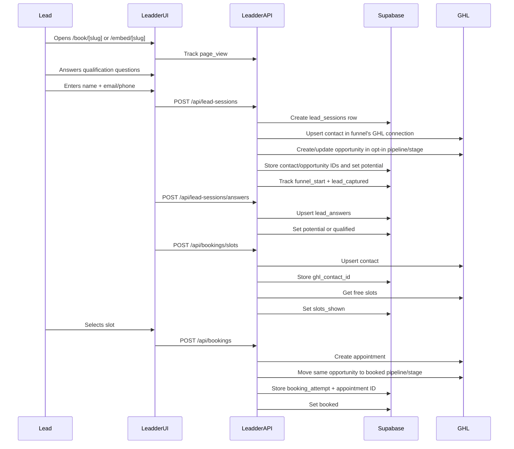

# Leadder Scheduler Architecture

## Product Boundary

Leadder Scheduler is not a replacement calendar. It is a qualification and booking UX layer in front of GoHighLevel.

Leadder owns:

- Funnel rendering
- Question flows
- Lead capture
- Qualification status
- GHL account routing
- GHL opportunity handoff
- Booking UI
- Funnel analytics

GHL owns:

- Contacts
- Opportunities
- Pipelines
- Appointments
- Workflows
- Reminders
- CRM records

## Request Flow

## Service Boundaries

- `lib/funnels/service.ts`: funnel, question, option, theme, and logo writes.
- `lib/lead-sessions/service.ts`: lead capture, answer normalization, qualification, status changes.
- `lib/bookings/service.ts`: GHL contact upsert, slot lookup, appointment creation, booking attempts.
- `lib/ghl/*`: server-only GHL HTTP boundary, tenant connection runtime config, opportunity handoff.
- `lib/analytics/service.ts`: durable event tracking and aggregate metrics.

React components call API routes or server actions. Business logic stays in services.

## GHL Integration Notes

The GHL API boundary is server-only. The browser never receives GHL tokens.

MVP endpoints:

- Contact upsert: `POST /contacts/upsert`
- Free slots: `GET /calendars/:calendarId/free-slots`
- Appointment creation: `POST /calendars/events/appointments`
- Search opportunity: `GET /opportunities/search`
- Create opportunity: `POST /opportunities/`
- Update opportunity: `PUT /opportunities/:id`

Each funnel references `ghl_connection_id`. All GHL calls resolve that funnel's connection and use its location ID, token, API base URL, and API version. Funnel-specific `calendar_id` overrides the connection default calendar.

`ghl_connections.private_token_ciphertext` stores a versioned AES-256-GCM ciphertext envelope. GHL tokens are encrypted before database storage and decrypted only server-side when constructing a GHL runtime config.

## Schema Design

The schema is multi-tenant from the first migration:

- Tenant-owned configuration: `ghl_connections`, `funnels`, `questions`, `question_options`
- Tenant-owned activity: `lead_sessions`, `lead_answers`, `booking_attempts`, `analytics_events`
- Admin membership: `tenant_members`

Questions, options, themes, slugs, calendar IDs, GHL connection IDs, opt-in pipeline destinations, booked-call pipeline destinations, embed settings, and future routing/scoring/disqualification settings are data-driven. Public routes load published funnel configuration by globally unique slug.

Future flow support is present through:

- `questions.conditional_logic`
- `questions.branching_logic`
- `funnels.routing_rules`
- `funnels.scoring_rules`
- `funnels.disqualification_rules`

## Status Model

`lead_sessions.status` supports:

- `started`
- `potential`
- `qualified`
- `slots_shown`
- `booked`
- `abandoned`
- `error`

`lead_status_history` records every status transition through database triggers.

## Analytics MVP

Raw events are written to `analytics_events`:

- `page_view`
- `funnel_start`
- `lead_captured`
- `qualified_lead`
- `slots_shown`
- `appointment_booked`
- `booking_error`
- `abandoned`

Rates are computed in service code for now. This keeps the table flexible for future reports without prematurely adding rollup infrastructure.

Admin funnel performance currently reports:

- Unique visitors
- Page views
- Opt-in count
- Opt-in rate
- Calls booked count
- Call booking rate
- Visitor to booked rate

Date filters support today, yesterday, last 7 days, last 30 days, and custom ranges.

## Meta events

A tenant can add Meta pixels (`meta_pixels`: dataset id, access token encrypted with `LEADDER_TOKEN_ENCRYPTION_KEY`, optional test event code). Each form chooses one pixel or none, and only after the tenant confirms they have consent to send lead data to Meta. Meta is contacted only for forms that use a pixel, and only from the server through the Conversions API. The Graph API version is the one constant `META_GRAPH_API_VERSION` in `lib/meta/constants.ts`; the token travels in the request body, never in a URL, and is never logged.

| FormBook event | Meta name | Standard or custom | When it fires | On by default |
|---|---|---|---|---|
| Form view | `ViewContent` | Standard | A visitor opens the form. | Yes |
| Form start | `FormStart` | Custom | A visitor answers the first question or starts typing. | Yes |
| Lead | `Lead` | Standard | A visitor submits their contact details. | Yes |
| Qualified lead | `QualifiedLead` | Custom | A lead answers every required question without being disqualified. | Yes |
| Disqualified lead | `DisqualifiedLead` | Custom | A lead gives an answer that disqualifies them. | No |
| Booked call | `Schedule` | Standard | A lead books a call. | Yes |

Each event can be switched on or off per pixel. The "Send test event" button sends one `ViewContent` with the pixel's test event code; it is the only Meta call made at the user's request.

**Event id.** `fbk1.{event}.{ref}`, where `ref` is the browser's page load id for form view and form start, a random reference stored once per lead (`lead_sessions.meta_event_ref`) for the four lead events, and a random id for test events. Event ids are posted to the embedding page, so they never contain the lead session id, which the public lead APIs accept. The same event always gets the same id, and the queue has a unique index on `(pixel_id, event_id)`, so retries never count twice.

**User data.** Hashed with SHA-256 after normalising: email, phone, first and last name, city, region, country and external id (the visitor id). Sent as is: client IP address, user agent, `fbp` and `fbc` (built from `fbclid` when the cookie is missing, using the time the browser first saw that click id).

**Queue and log.** `meta_event_deliveries` is both the delivery queue and the event log the tenant reads at `/admin/pixels/{id}/events` (and per lead at `/admin/leads/{id}`). Rows are sent right after the response with `after()` and every 5 minutes by `GET /api/cron/meta-events` (Bearer `CRON_SECRET`). Failed sends are retried with backoff (up to 6 attempts). A failure never blocks or slows lead capture or booking. The log never shows payloads or tokens.

| Status | Meaning |
|---|---|
| `awaiting_consent` | Sent only if the visitor ticks the consent box. Cancelled after 24 hours. |
| `held` | Waiting for the tenant to send it (pixel in "Hold for review" mode). Can be sent for 7 days. |
| `pending` | Queued for Meta; retried on failure. |
| `sent` | Meta received it. |
| `failed` | Meta did not accept it, or every retry failed. |
| `skipped` | Not sent because of a setting at send time (event switched off, pixel removed, or the form no longer uses this pixel, is not active, or its account is suspended). |
| `expired` | Older than Meta's 7-day limit. |
| `cancelled` | The visitor did not give consent, or the form stopped using this pixel before the event was sent. |

**Hold and fire.** In "Hold for review" mode new events wait as `held`. "Send held events to Meta" on a lead's page releases that lead's events (including its earlier view and start) and marks the lead released, so its later events go out automatically. "Send all held events" on the pixel page releases every held event of the pixel. Switching back to automatic does not send events that are already held. Only events whose form still uses the pixel (with the consent confirmation) are released. The cron sends the oldest released events first.

**Consent.** With the optional consent checkbox on a form, view and start events wait for the visitor's answer; a visitor who does not tick it gets nothing sent, ever.

**Match quality.** `/admin/pixels/{id}/quality` shows how often queued events carry each match key, computed from our own log. It is not Meta's Event Match Quality score.

**Browser deduplication.** After an event is queued for sending (not while it is held), the form posts `{ type: "formbook:meta-event", event_name, event_id }` to the parent page (and opener) with `postMessage`. The optional browser pixel bridge snippet on the pixel settings page listens for it and calls `fbq('track' | 'trackCustom', event_name, {}, { eventID: event_id })`, so a site that also runs the Meta browser pixel reports each event once.

## Security Review

- GHL credentials remain server-side.
- GHL tokens are encrypted at rest with `LEADDER_TOKEN_ENCRYPTION_KEY`.
- Admin UI is protected by Supabase Auth middleware when Supabase auth env vars are present.
- Admin API routes require an authenticated Supabase user in configured environments.
- Supabase service role is used server-side only.
- Public routes only receive published funnel configuration and lead/session IDs.
- RLS policies are defined in `0005_security_hardening.sql`.
- GHL tokens are never sent to browser code.

## Refactor Risks

- GHL response shapes should be validated against real customer calendars during integration QA.
- Tenant membership needs first-class UI before onboarding multiple agencies.
- Legacy plaintext GHL tokens must be rotated after deploying encryption.
- Analytics aggregation will need SQL views or materialized rollups when traffic grows.
- The question builder is intentionally functional, not polished; it should become a dedicated admin UX before non-technical users rely on it.
- Public slug routing is globally unique today. Custom domains or tenant pathing are needed if duplicate slugs across tenants become a product requirement.
